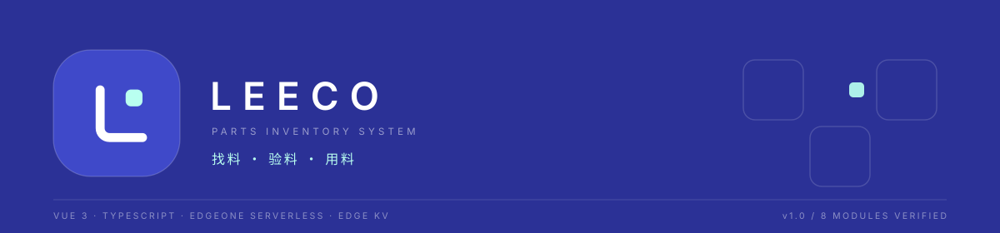
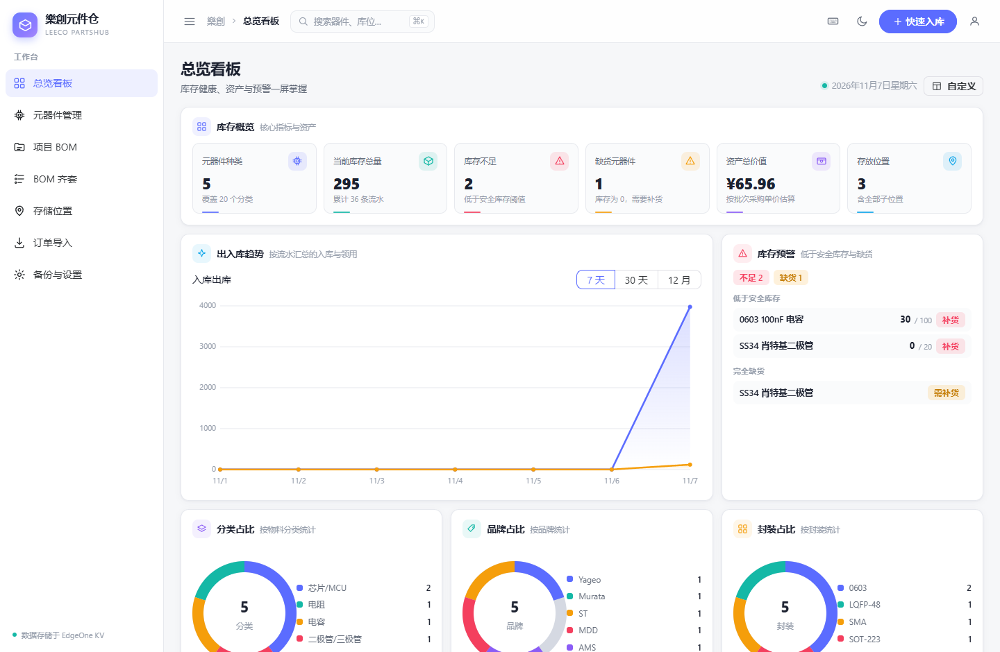
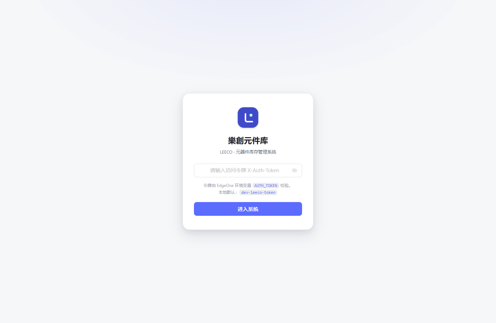
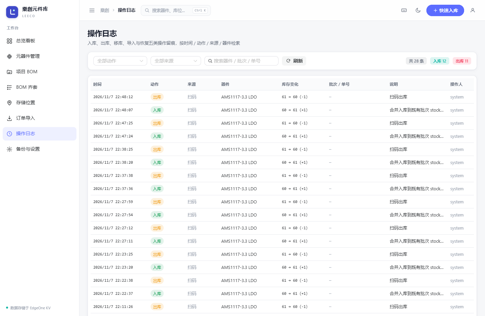
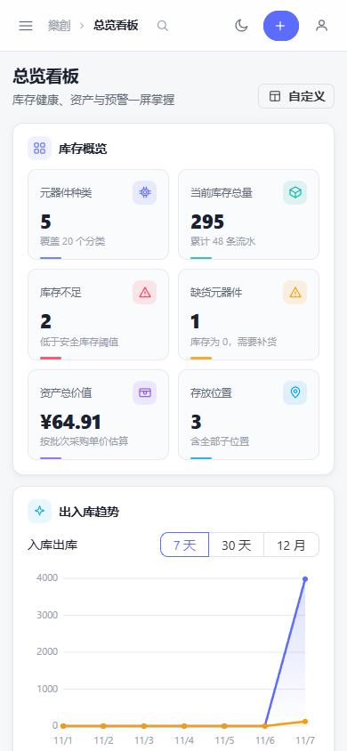
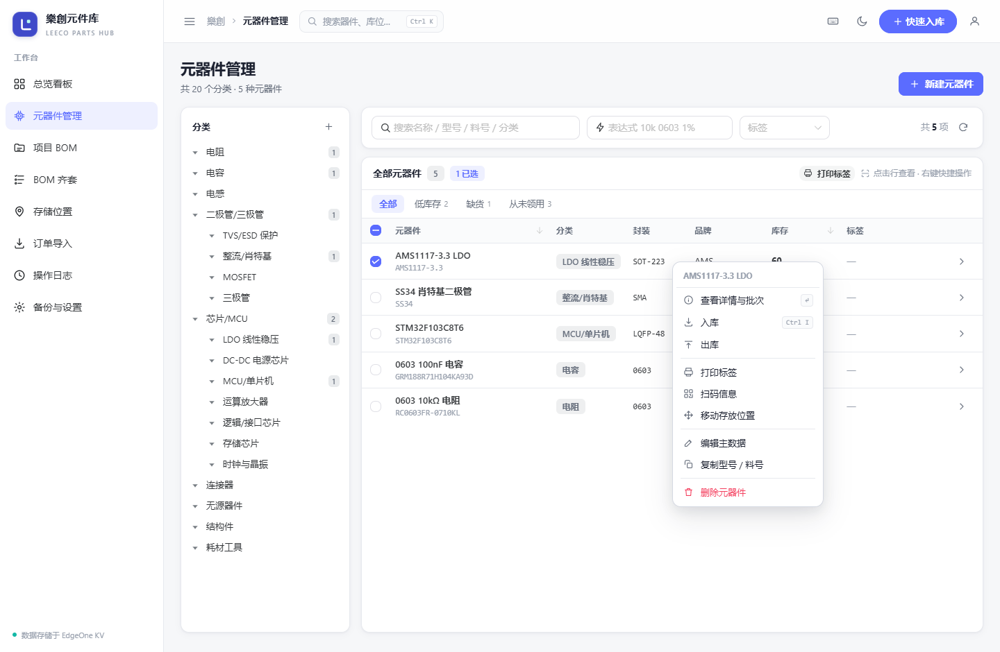

<div align="center">



<h1>樂創元件库</h1>

<p><strong>Leeco PartsHub</strong> &nbsp;·&nbsp; 面向个人与小团队的元器件库存管理系统</p>

<p>从多渠道订单导入，到分类检索、批次库位、扫码出入库、BOM 齐套与项目领料，<br />
把「找料 → 验料 → 用料」收进一条链路。</p>

<p>
  
  
  
  
  
</p>

</div>

---

> **架构一句话**：静态前端 + 边缘函数 + 边缘 KV，没有常驻服务器。
>
> 本地用 Node 服务与 FileKV 等价运行，接口与业务逻辑完全一致。



## 它能做什么

<table>
  <tr>
    <td width="50%" valign="top">
      <b>主数据与检索</b><br />
      树形分类、中文参数模板、EIA 编码与工程单位归一、型号 / 表达式 / 分类 / 标签检索、安全库存与替代料
    </td>
    <td width="50%" valign="top">
      <b>库存与库位</b><br />
      父子位置树、批次单价与来源、FIFO 出库、整颗料 / 指定批次移动、流水追溯、扫码合并入库
    </td>
  </tr>
  <tr>
    <td width="50%" valign="top">
      <b>导入与 BOM 齐套</b><br />
      立创 / 贸泽 / 得捷订单解析去重、粘贴 / Excel / CSV BOM、三级匹配、缺料汇总、一键领料
    </td>
    <td width="50%" valign="top">
      <b>项目 BOM</b><br />
      按单套用量保存、投产套数换算、齐套率与匹配率、按项目领料写流水、导出 CSV
    </td>
  </tr>
  <tr>
    <td width="50%" valign="top">
      <b>标签与二维码</b><br />
      46×30mm / 60×40mm 标签，扫码文本承载器件参数与库位，A4 版式预览，兼容已打印的旧标签
    </td>
    <td width="50%" valign="top">
      <b>效率工具</b><br />
      <code>Ctrl+K</code> / <code>Ctrl+I</code> / <code>Ctrl+S</code>、<code>Alt+1…9</code>、全局右键菜单、可拖拽自定义看板、命令面板
    </td>
  </tr>
  <tr>
    <td width="50%" valign="top">
      <b>数据可信</b><br />
      只追加的操作日志、导入 10 分钟内撤销、备份结构校验 / 预演 / <code>RESTORE</code> 确认 / 失败整体回滚
    </td>
    <td width="50%" valign="top">
      <b>看板与数据</b><br />
      周月年趋势、分类与品牌占比、全量导出恢复、暗色主题、390px 移动端适配
    </td>
  </tr>
</table>

## 快速开始

环境要求：Node ≥ 18.17、npm ≥ 9。

```bash
npm ci
npm run dev:all      # Vite 5173 + 本地 API 8787
```

打开 <http://127.0.0.1:5173>，本地默认免密。演示数据可随时写入与清理：

```bash
npm run seed         # 写入演示器件、位置与项目
npm run seed:clean   # 按 .data/demo-ids.json 清理
```

> 本地数据落在 `.data/local-kv.json`，与生产 EdgeOne KV 完全隔离。<code>KV_FILE</code> 与 <code>PORT</code> 可覆盖默认路径与端口，逐模块验证脚本正是借此启动独立实例。

## 界面一览

<table>
  <tr>
    <td width="50%" valign="top">
      <br />
      <sub>登录页 · 品牌与令牌入口</sub>
    </td>
    <td width="50%" valign="top">
      <br />
      <sub>操作日志 · 出入库 / 移库 / 导入 / 恢复留痕</sub>
    </td>
  </tr>
</table>

<p align="center">
  <br />
  <sub>390px 移动端 · 卡片单列，无横向溢出</sub>
</p>

<details>
<summary>更多界面截图</summary>



</details>

## 架构

```text
浏览器 ── /api ──▶ EdgeOne 边缘函数 ──▶ http ──▶ application ──▶ repositories ──▶ 边缘 KV
                        └─ 本地等价替换为 tools/dev-server + FileKV

domain（归一化 / 二维码 / 扫码 / BOM 解析与汇总 / 参数模板）是纯函数，前后端共用，不含任何 IO
```

- **服务端单向**：`http → application → repositories → infrastructure`，领域层不反向依赖任何层。
- **前端单向**：`app → modules → shared`；模块之间只通过 `index.ts` 公开出口复用。
- **同构**：边缘函数与本地开发服务复用同一个 `server/http/router.js`，接口行为一致。

<details>
<summary>展开完整目录</summary>

```text
src/
  app/            应用壳：路由、布局、全局命令面板
  modules/        业务模块：auth / dashboard / catalog / inventory / bom
                  / projects / procurement / labels / platform
  shared/         API 传输层与端点、设计系统组件、主题与全局状态
  styles/         设计令牌与全局样式
server/
  domain/         纯业务规则（无 IO）
  application/    用例编排：出入库、齐套、项目、导入撤销、备份
  repositories/   KV 持久化与索引
  infrastructure/ KV 适配器与种子数据
  http/           路由表、鉴权、统一响应
functions/        EdgeOne 边缘入口（薄适配）
tests/            unit / integration / e2e / verification
tools/            本地 API 服务、演示数据、路径自检脚本
docs/             架构、开发、接口、验证报告与 ADR
```

</details>

完整分层、KV 键设计与扩展指引见 [docs/ARCHITECTURE.md](docs/ARCHITECTURE.md)。

## 命令速查

| 命令 | 作用 |
| --- | --- |
| `npm run dev:all` | 同时启动前端 5173 与本地 API 8787 |
| `npm run check` | 路径自检 + 类型检查 + 单测 + 接口契约 + 构建 |
| `npm run verify` | 完整门禁 + 8 个后端模块闭环 + 9 个前端页面逐路由（需先启动 `dev:all`） |
| `npm run verify:modules` | 隔离实例自启动 / 自清理，不触碰演示库 |
| `npm run verify:ui` | 浏览器只读核对，含快捷键、主题与移动端 |
| `npm run build` | 生产构建，产物 `dist` |
| `npm run seed` / `seed:clean` | 写入 / 清理演示数据 |

## 质量与验证

| 检查 | 结果 |
| --- | --- |
| `vue-tsc` 类型检查 | 0 错误 |
| 领域与用例单测 | 158 / 158 |
| 进程内 API 契约 | 44 / 44 |
| 后端 8 模块功能闭环 | 98 / 98 |
| 前端 9 页面逐路由 | 38 / 38 |
| Playwright 端到端脚本 | 8 / 8 通过 |
| 路径可移植性自检 | 118 个文件，0 命中 |

一键复现：`npm run verify`。逐模块结论、发现的缺陷与数据基线见 [逐模块验证报告](docs/VERIFICATION-REPORT.md)。

## 部署到 EdgeOne Pages

```bash
npm run build        # 产物 dist
```

1. `edgeone.json` 已声明构建命令 `npm run build`、产物目录 `dist`、Node 版本 `22.11.0` 与静态资源缓存头。
2. 边缘函数入口 `edge-functions/api/[[default]].js`（`/api` 下多级 catch-all，默认导出 `onRequest`）。
3. 创建边缘 KV 命名空间 `leeco-partshub`，绑定为 Edge Functions 环境变量 `KV`；适配器会自动编码含 `:` / 中文的 key。
4. 配置强随机 `AUTH_TOKEN`。绑定 KV 后若漏配令牌会被直接拒绝（fail-closed），生产环境**不要**设置 `AUTH_DISABLED`。
5. 首次访问任意接口会写入默认分类；可用「备份与设置」导出本地数据后在线恢复。Edge Functions 单次请求体上限 **1MB**，附件与备份文件过大时请拆分或改用外链。

| 变量 | 作用 | 生产要求 |
| --- | --- | --- |
| `AUTH_TOKEN` | 接口令牌，前端登录时输入相同值 | 必填，勿提交到仓库 |
| `KV` | EdgeOne 边缘 KV 绑定（全局变量或 `env.KV`） | 由控制台注入 |
| `AUTH_DISABLED` | `1` 时跳过鉴权 | 禁止设置 |
| `KV_FILE` / `PORT` | 本地 FileKV 路径与端口 | 仅本地使用 |

本地可把令牌写入项目根目录 `.env`（已 gitignore），执行 `npm run dev:api` 时自动读取；离线桌面版不校验令牌。

详细步骤见 [docs/DEVELOPMENT.md](docs/DEVELOPMENT.md)。

### 备选：Cloudflare Pages + KV（免费、免审核，无需本地安装）

EdgeOne KV 需要申请审核；不想等可以改用 Cloudflare Pages，全程在网页控制台操作：

1. Cloudflare 控制台 → **Workers & Pages** → **Create** → **Pages** → **Connect to Git**，选择本仓库。
2. 构建配置：命令 `npm run build`，输出目录 `dist`，框架预设 `Vite`。
3. 项目 → **Settings → Environment variables**，添加：
   - `AUTH_TOKEN` = 你的访问密码（强随机值）
   - `NODE_VERSION` = `22`
   - `ELECTRON_SKIP_BINARY_DOWNLOAD` = `1`（跳过桌面版 Electron 二进制下载，加快构建）
   - 不要添加 `AUTH_DISABLED`
4. 项目 → **Settings → Functions → KV namespace bindings**，创建命名空间 `leeco-partshub`，**变量名填 `KV`**（Production 与 Preview 都绑定）。
5. **Retry deployment**，访问 `https://<项目名>.pages.dev`，输入 `AUTH_TOKEN` 相同的密码登录。

入口已在仓库中：`functions/api/[[path]].js`（与 EdgeOne 入口共用同一份服务端逻辑）。免费额度为读 10 万次/天、写 1000 次/天、存储 1GB，个人使用足够；超出后写入会被限流，需要等待次日重置。数据迁移：本地「备份与设置」导出 JSON → 线上登录后恢复。

## 嘉立创开放平台接入

器件信息查询有两条通道，服务端代理，密钥不进前端：

| 通道 | 条件 | 能查到 |
| --- | --- | --- |
| **嘉立创 EDA 公开器件库**（默认） | 无需密钥，只要立创商城 C 料号 | 名称、型号、品牌、封装、规格值、价格、库存、商品链接 |
| **嘉立创开放平台**（可选） | 创建应用并申请接口权限，配置下表变量 | 以授权接口返回为准 |

官方开放平台变量（不配也能用公开库）：

| 变量 | 说明 |
| --- | --- |
| `JLC_APP_ID` | 应用 ID（控制台创建应用后获得） |
| `JLC_ACCESS_KEY` | API 密钥 AccessKey（密钥的唯一标识） |
| `JLC_SECRET_KEY` | API 密钥 SecretKey（参与 HmacSHA256 签名，切勿泄露） |
| `JLC_COMPONENT_PATH` | 器件查询接口路径，按应用获授权的 API 文档填写，如 `/component/v1/detail` |
| `JLC_BASE_URL` | 可选，默认 `https://open-api.jlc.com` |

官方通道实现要点（`server/infrastructure/jlc/client.js`）：

- 仅 HTTPS + POST + JSON，UTF-8
- 签名串：`POST\n路径\n秒级时间戳\n32位随机串\n请求体JSON\n`，用 SecretKey 做 HmacSHA256 后 Base64
- 请求头：`Authorization: JOP appid="…",accesskey="…",nonce="…",timestamp="…",signature="…"`
- 失败时保留 `J-Trace-ID` 便于官方客服定位

公开库实现（`server/infrastructure/easyeda/client.js`）：只读 `https://easyeda.com/api/products/{料号}/components`，把 `c_para` 与 `lcsc.price/stock` 归一化成统一结构；`R0603` 这类封装会自动归一为 `0603`。

使用方式：「订单导入」页底部「器件信息查询」输入料号（如 `C25804`）→ 查询。优先走官方通道，未配置或查询失败时自动回退到公开库；非 C 料号且未配置密钥时会提示改用料号查询。

> 注意：公开库是嘉立创 EDA 编辑器自身使用的数据源，官方可能调整结构，届时只需改 `easyeda/client.js`。离线桌面版不联网，该入口自动隐藏且接口返回 501。

## 离线桌面版（Electron）

面向无网络或不想依赖 EdgeOne 的场景。应用内置本地服务，数据保存在本机，和线上 KV 完全隔离；两份数据通过「备份与设置」手动导出/恢复。

安装包下载：[GitHub Releases v1.1.0](https://github.com/LeChuangDev/leeco-partshub/releases/latest)

```bash
npm run offline:dev     # 构建离线前端并启动桌面版
npm run offline:pack    # 生成 Windows 安装包 release/LeecoPartsHub-1.1.0-x64.exe
npm run offline:dir     # 只生成免安装目录 release/win-unpacked
```

- 内置服务复用 `server/http/router.js` + `FileKV`，静态资源与 `/api` 都走 `127.0.0.1` 随机端口，不监听外网。
- 数据目录：应用菜单「文件 → 打开数据目录」；Windows 默认在 `%APPDATA%\leeco-partshub\data\local-kv.json`。
- 离线版无需令牌，启动自动进入；附件与备份不受 EdgeOne 1MB 请求体限制。
- 离线版不联网：嘉立创等第三方接口代理在离线版中关闭（接口返回 501，界面对应入口隐藏）。
- 安装包未配置代码签名，首次运行可能出现 SmartScreen 提示，选择「仍要运行」即可。

国内网络打包前可先设置镜像：

```powershell
$env:ELECTRON_MIRROR='https://npmmirror.com/mirrors/electron/'
$env:ELECTRON_BUILDER_BINARIES_MIRROR='https://npmmirror.com/mirrors/electron-builder-binaries/'
```

## 文档

| 文档 | 内容 |
| --- | --- |
| [架构说明](docs/ARCHITECTURE.md) | 分层、依赖规则、KV 键设计、请求链路、扩展指引 |
| [开发与部署](docs/DEVELOPMENT.md) | 环境、脚本、本地数据、测试、EdgeOne 部署 |
| [API 参考](docs/API.md) | 全部接口、参数、业务约束与统计口径 |
| [逐模块验证报告](docs/VERIFICATION-REPORT.md) | 8 个后端模块 98 项 + 9 个前端页面 38 项 |
| [报告改进对照](docs/REPORT-REMEDIATION.md) | 分析报告 v2 各优先级的落地状态与取舍 |
| [ADR 0001](docs/adr/0001-layered-architecture.md) | 为什么采用当前分层 |

## 品牌

<p align="center"></p>

中文主名「**樂創元件库**」，英文副标「**LEECO**」，产品标识 `Leeco PartsHub`，技术标识 `leeco-partshub`（包名与 KV 命名空间）保持不变。标记是单色印章式：一条圆角 L 形路径代表 Leeco 与料架，右上薄荷小方代表一枚元件，去渐变、仅两个几何元素。

品牌文案的唯一来源是 `src/shared/brand.ts`（界面与页面标题）与 `server/domain/brand.js`（二维码文本）；`index.html` 静态值仅作无脚本兜底。新二维码写新名，扫码解析通过 `KNOWN_BRAND_TITLES` 同时接受旧名，已打印的标签仍可识别。

## 当前范围

已实现并验证：主数据、库存与库位、订单导入、BOM 齐套、项目 BOM、标签二维码、看板备份、操作日志、效率工具。

尚未实现：第三方器件信息代理仍为占位接口；库存盘点、批次保质期、智能采购清单、PWA 与多用户权限属于后续范围，原因与阶段边界见 [报告改进对照](docs/REPORT-REMEDIATION.md)。

---

<div align="center">樂創元件库 · 用工程师的方式管理每一颗料</div>
